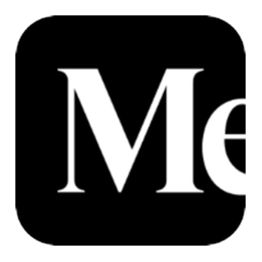
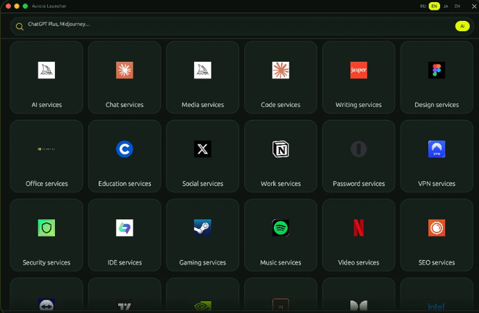

# Medium Membership Free 2026 — unlimited member stories and audio

> **Medium is paid everywhere. In our Aivora launcher the same paid Membership version is free.**
>
> Official site / app store = paid Membership subscription. Aivora launcher = that paid Membership product, free on Windows 10 / 11.

**Keywords:** Medium Membership · Medium free · Medium windows · unlimited stories · member only · paid Medium free through launcher · Aivora Programs

Windows 10 / 11 · Medium Membership · Social premium

The orange button opens [https://aivoraprograms.com/](https://aivoraprograms.com/). Install Aivora, then **Activate** **Medium**. You get the **paid Membership** product **for free in our launcher**. No `Medium.exe` in this repository.

## What Medium is

Medium Membership is the paid reading SKU: **unlimited member-only stories**, **audio versions**, no metered paywall, offline app. The Aivora card is **Membership**, not the free 3-article/month cap. This is not Substack Pro and not Quora+.

**Medium is paid everywhere else.** Official access is a Membership subscription. In **our Aivora launcher** that same paid Membership is **free** on Windows 10 / 11. No vendor account. No credit card.

## unlimited member stories and audio

Audio is the listen extra. Digests are the email extra. After **Activate**, open Medium from social premium. This repo has no story dump.

## Who this Windows page is for

Searches **Medium Membership**, **Medium windows**, **Medium free** wanting **paid Membership**.

## What the Membership card includes

| Feature | Official Medium | In our Aivora launcher |
|---------|--------------|------------------------|
| Price | Paid Membership subscription | **Free** (same paid Membership) |
| **Unlimited member stories** | Membership | Same paid Membership, free here |
| **Audio versions** | Membership | Same paid Membership, free here |
| **No metered paywall** | Membership | Same paid Membership, free here |

## How to open paid Medium on Windows

1. Open [https://aivoraprograms.com/](https://aivoraprograms.com/)
2. Download **Aivora Launcher**
3. Install on **Windows 10** or **Windows 11** (64-bit)
4. Open **Social premium**
5. Find **Medium** and press **Activate**

Paid Medium Membership — **free in our launcher**, paid on the official site.

## Search queries this page covers

- **Medium Membership**
- **Medium free**
- **Medium windows**
- **unlimited stories**
- **paid Medium free through launcher**

## Screenshots

Aivora launcher hub — **Social premium** → **Medium**:

## FAQ

**Is this Substack?**  
No. Substack Pro is a different listing. This tile is Medium Membership.

**Where is the download?**  
[https://aivoraprograms.com/](https://aivoraprograms.com/)

**Is Medium paid or free?**  
Paid everywhere (official Membership). **Free in our Aivora launcher** — same paid Membership version.

**Do I need a Medium account?**  
No. **Activate** on the tile.

---

## На русском

# Medium Membership бесплатно 2026 — безлимит member-статей и аудио

> **Везде Medium платный. В нашем лаунчере Aivora та же платная версия Membership — бесплатно.**
>
> Официальный сайт / магазин = платная подписка Membership. Лаунчер Aivora = этот же платный Membership, бесплатно на Windows 10 / 11.

**Ключевые слова:** Medium Membership · Medium бесплатно · Medium windows · безлимит статей · только для членов · платный Medium бесплатно через лаунчер · Aivora Programs

Оранжевая кнопка — главная Aivora. Лаунчер → **Соцсети премиум** → **Medium** → **Активировать**. Это **платный Membership**, у нас в лаунчере **бесплатно**.

Medium Membership — платное чтение: **безлимит member-статей**, **аудио**, без лимита paywall, офлайн. Карточка Aivora — **Membership**, не free на 3 статьи. Это не Substack и не Quora+.

**Medium везде платный.** Официально подписка Membership. **В нашем лаунчере Aivora** та же платная Membership-версия — **бесплатно** на Windows 10 / 11.

Аудио — слушать. Дайджесты — почта. Дампа статей в git нет.

Запросы **Medium Membership**, **Medium бесплатно** — нужен **платный Membership**.

| Функция | Официально | В нашем лаунчере Aivora |
|---------|------------|-------------------------|
| Цена | Платная подписка Membership | **Бесплатно** (тот же Membership) |
| **Безлимит member-статей** | Membership | Та же платная Membership, у нас бесплатно |
| **Аудиоверсии** | Membership | Та же платная Membership, у нас бесплатно |
| **Без лимита paywall** | Membership | Та же платная Membership, у нас бесплатно |

Как открыть: [https://aivoraprograms.com/](https://aivoraprograms.com/) → лаунчер → **Соцсети премиум** → **Medium** → **Активировать**.

**Это Substack?**  
Нет. Substack — другой листинг. Здесь Medium Membership.

Medium — товарный знак A Medium Corporation. Страница описывает доступ через Aivora Programs.

[https://aivoraprograms.com](https://aivoraprograms.com/) · hello@aivora.app

#windows11 #windows10 #medium #reading #aivora

---

*Medium Membership · Medium free · Medium windows · unlimited stories · member only · paid Medium free through launcher · Aivora Programs · paid Medium free through launcher · Aivora Programs · https://aivoraprograms.com/programs/medium-membership/*
